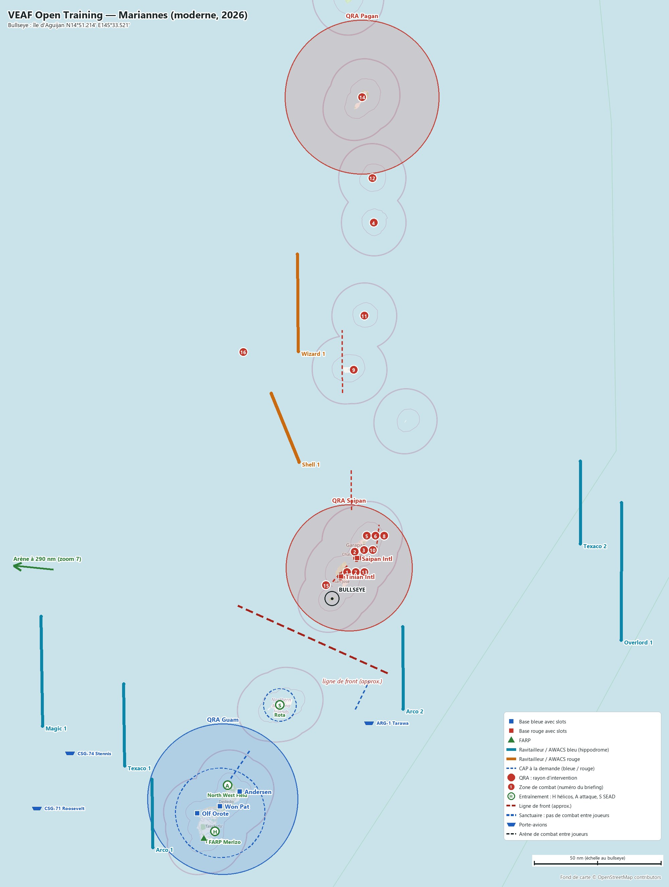
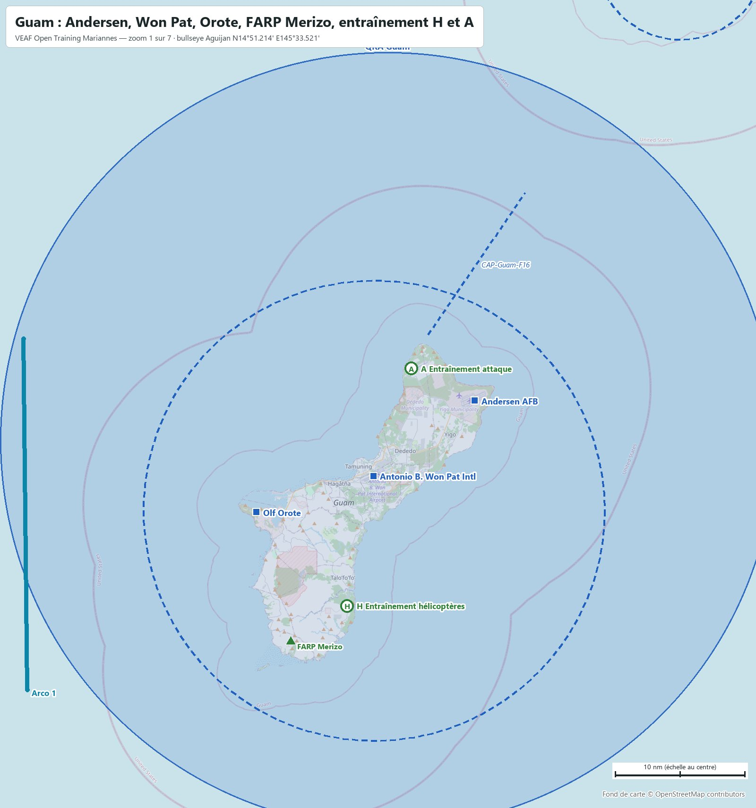
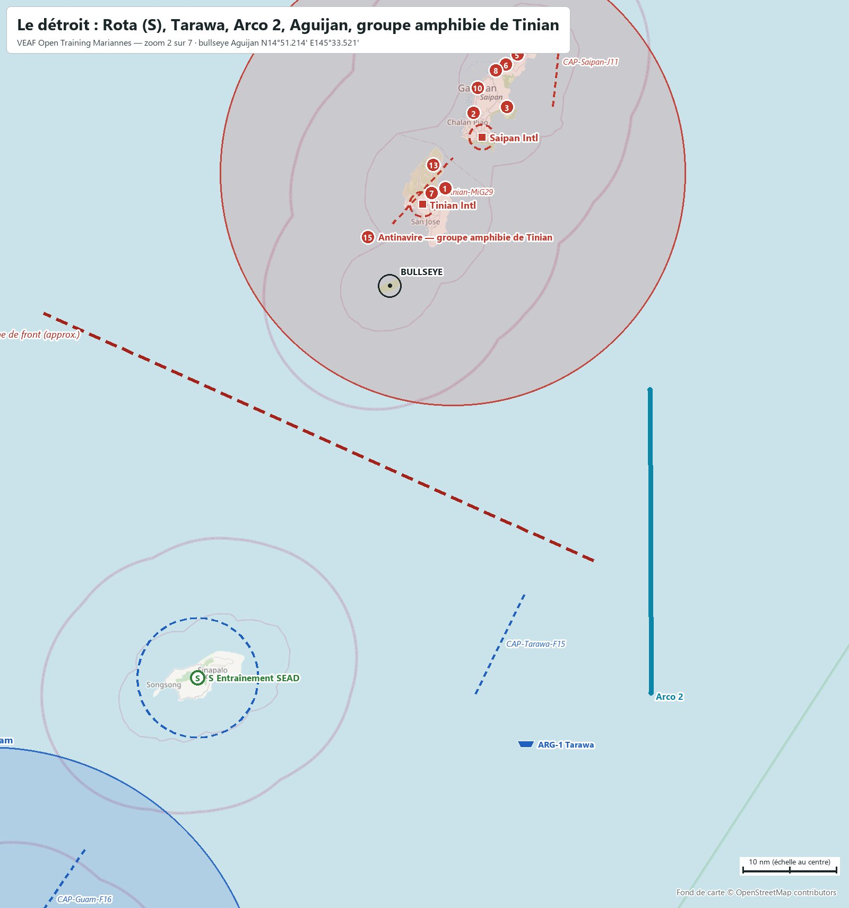
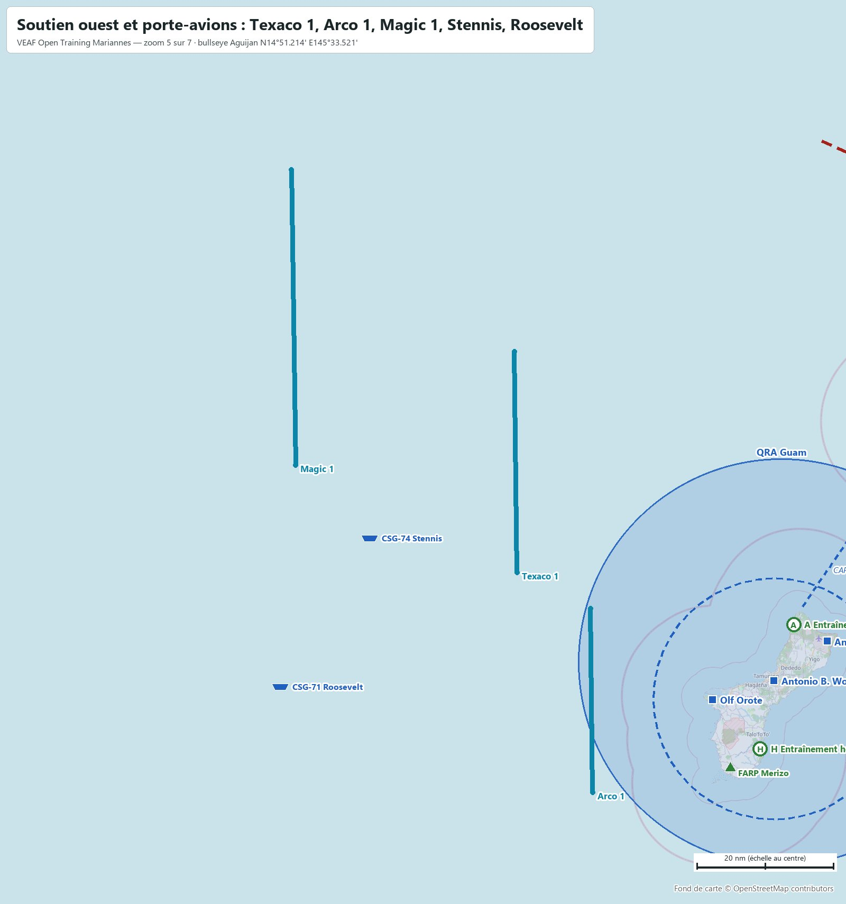
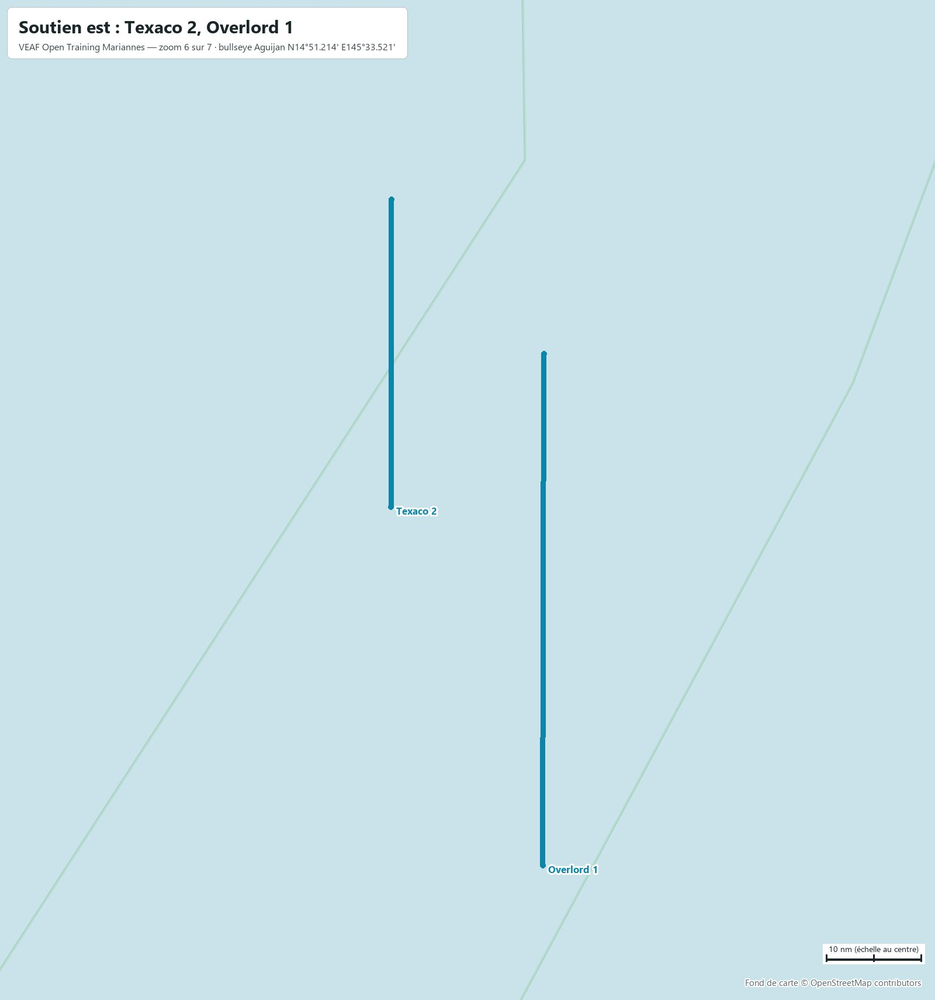
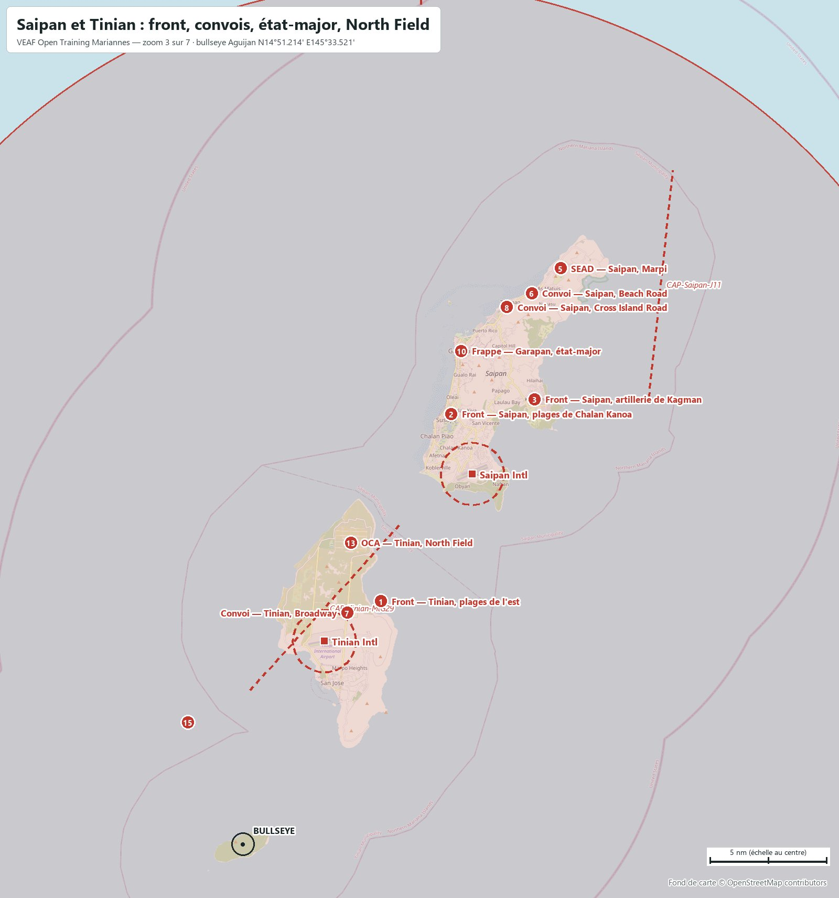
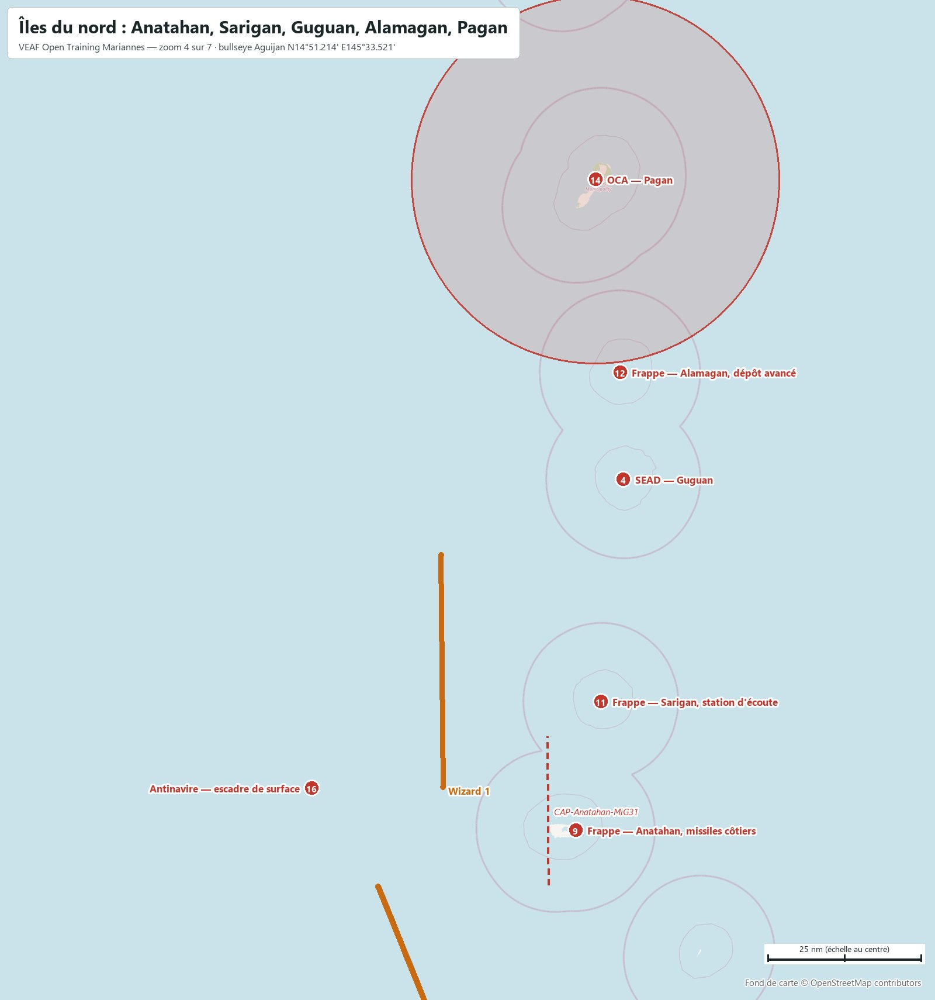
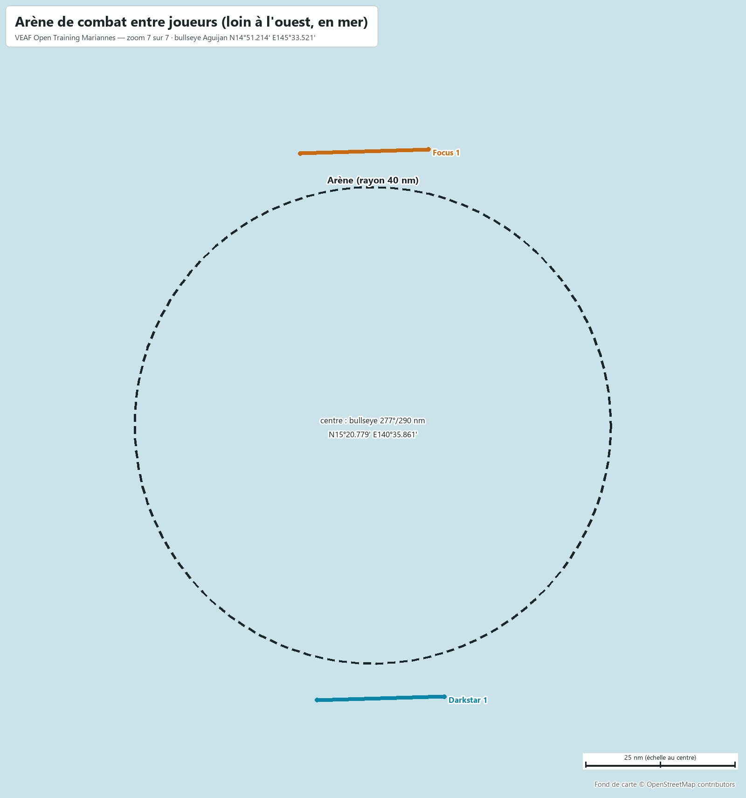

# VEAF Open Training — Mariannes (moderne, 2026)

Mission d'entraînement ouverte des serveurs VEAF, sur la carte **Mariannes** de DCS, dans un scénario moderne. Ce document est le briefing complet : bases, soutien, zones, QRA, CAP, radio, météo. Les positions sont données en coordonnées (degrés, minutes décimales) et en relèvement/distance depuis le bullseye (relèvement vrai, nautiques).

| Mission | Date | Heure de base | Bullseye (bleu et rouge) | Météo réelle | ATC |
|---|---|---|---|---|---|
| `VEAF_OpenTraining_Marianas_ICAO_PGUA` | 15/03/2026 | 09:00 (heure de la carte, UTC+10) | île d'Aguijan · `N14°51.214' E145°33.521'` | PGUA (Andersen) | coupé sur tous les aérodromes |

**Sommaire** : [Situation](#situation) · [Carte](#carte) · [Bases](#bases) · [Ravitailleurs et AWACS](#ravitailleurs-et-awacs) · [Porte-avions](#porte-avions) · [Drones laser](#drones-laser) · [Entraînement](#entraînement) · [Zones de combat](#zones-de-combat) · [Missions scénarisées](#missions-scénarisées) · [QRA](#qra) · [CAP à la demande](#cap-à-la-demande) · [Combat entre joueurs](#combat-entre-joueurs) · [Défense aérienne](#défense-aérienne) · [Plan radio](#plan-radio) · [Météo et heures](#météo-et-heures) · [Commandes utiles](#commandes-utiles) · [Pour les créateurs de mission](#pour-les-créateurs-de-mission)

## Situation

Une force rouge sino-russe a pris les Mariannes du Nord : Tinian et Saipan, puis les îles volcaniques jusqu'à Pagan, à 180 nm plus au nord. Les États-Unis tiennent Guam et ses quatre terrains, et deux groupes aéronavals croisent en mer des Philippines. Entre les deux, Rota a été évacuée et sert de champ de tir. Le front est un détroit : environ 50 nm de mer entre Rota et Tinian ; Andersen est à 94 nm de Tinian, Pagan à 276 nm d'Andersen. Le bullseye commun est l'île d'Aguijan, au milieu du détroit.

Zones de combat, missions et soutien se pilotent par le menu radio F10 (*Zones de combat*, *Missions de combat*, *Assets*).

## Carte



Cartes zoomées, reprises dans les sections qu'elles illustrent : [Guam](docs/cartes/carte_01_guam.jpg) · [Le détroit](docs/cartes/carte_02_detroit.jpg) · [Saipan et Tinian](docs/cartes/carte_03_saipan.jpg) · [Îles du nord](docs/cartes/carte_04_nord.jpg) · [Soutien ouest et porte-avions](docs/cartes/carte_05_ouest.jpg) · [Soutien est](docs/cartes/carte_06_est.jpg) · [Arène de combat entre joueurs (loin à l'ouest, en mer)](docs/cartes/carte_07_arene.jpg).

Carrés : bases avec slots (bleu / rouge). Triangles : FARP. Traits pleins : hippodromes des ravitailleurs et AWACS. Pointillés : CAP à la demande. Cercles pleins : QRA. Pastilles vertes : entraînement (H hélicoptères, A attaque, S SEAD). Pastilles rouges numérotées : zones de combat. Cercles en tirets : sanctuaires. Navires : porte-avions et LHA. La flèche verte en bordure montre l'arène, loin à l'ouest (zoom 7). Fond OpenStreetMap ; la ligne de front est approximative. Le briefing DCS montre cette carte puis les zooms (flèches sous l'image, molette pour grossir) ; la carte F10 porte les mêmes dessins : front, zones, QRA, sanctuaires et arène pour les deux camps, hippodromes de soutien pour leur camp seulement.

## Bases

| Base | Camp | Position | Bullseye | UHF | VHF | FM | Défense |
|---|---|---|---|---|---|---|---|
| **Andersen AFB** (base mère) | Bleu | `N13°34.902' E144°55.863'` | `206°/84 nm` | `250.1` | `126.2` | `38.6` | Patriot + Hawk + Avenger + Radar d'alerte FPS-117 |
| **Antonio B. Won Pat Intl** | Bleu | `N13°29.087' E144°47.809'` | `209°/93 nm` | `340.2` | `118.1` | `38.55` | Hawk + Avenger |
| **Olf Orote** | Bleu | `N13°26.292' E144°38.535'` | `213°/100 nm` | `—` | `—` | `—` | NASAMS + Avenger |
| **Saipan Intl** | Rouge | `N15°07.136' E145°43.748'` | `032°/19 nm` | `256.9` | `125.7` | `38.45` | SA-11 + SA-15 + Radar d'alerte 55G6 + HQ-7 |
| **Tinian Intl** | Rouge | `N14°59.952' E145°37.151'` | `022°/9 nm` | `250.05` | `123.65` | `38.5` | SA-11 + SA-15 |
| **FARP Merizo** | Bleu | `N13°16.327' E144°41.243'` | `209°/107 nm` | — | — | `40.0` | Stinger, dépôt de munitions (CTLD) |

Slots dynamiques, démarrage moteur chaud, carburant et munitions illimités. Les autres aérodromes de chaque camp lui appartiennent, sans slots : North West Field (bleu, champ de tir attaque) et Pagan (rouge, piste courte, cible OCA). Rota est neutre. Fréquences : celles que DCS donne à chaque tour (ATC coupé) ; Olf Orote n'en a pas dans DCS.

<table><tr><td width="50%"><a href="docs/cartes/carte_01_guam.jpg"></a><br><sub>Guam : Andersen, Won Pat, Orote, FARP Merizo, entraînement H et A</sub></td><td width="50%"><a href="docs/cartes/carte_02_detroit.jpg"></a><br><sub>Le détroit : Rota (S), Tarawa, Arco 2, Aguijan, groupe amphibie de Tinian</sub></td></tr></table>

## Ravitailleurs et AWACS

| Indicatif | Camp | Appareil | Rôle | UHF | TACAN | Niveau | Bullseye (milieu) | Hippodrome (extrémités) | Escorte |
|---|---|---|---|---|---|---|---|---|---|
| **Texaco 1** | Bleu | KC-135 | perche · ouest | `290.0` | `50Y` | `FL220` | `239°/96 nm` | `N13°44.966' E144°08.889'`<br>`N14°17.476' E144°08.487'` | oui |
| **Arco 1** | Bleu | KC135MPRS | panier · ouest | `291.0` | `51Y` | `FL180` | `221°/111 nm` | `N13°12.573' E144°20.337'`<br>`N13°39.670' E144°20.037'` | oui |
| **Magic 1** | Bleu | E-3A | AWACS · ouest | `282.0` | — | `FL300` | `257°/118 nm` | `N14°00.790' E143°35.402'`<br>`N14°44.113' E143°34.743'` | oui |
| **Texaco 2** | Bleu | KC-135 | perche · est | `292.0` | `52Y` | `FL240` | `069°/105 nm` | `N15°12.747' E147°14.850'`<br>`N15°45.294' E147°14.889'` | oui |
| **Arco 2** | Bleu | KC135MPRS | panier · détroit | `293.0` | `53Y` | `FL200` | `135°/39 nm` | `N14°07.542' E146°02.512'`<br>`N14°40.088' E146°02.373'` | oui |
| **Overlord 1** | Bleu | E-3A | AWACS · est | `283.0` | — | `FL310` | `085°/115 nm` | `N14°34.747' E147°31.517'`<br>`N15°28.992' E147°31.650'` | oui |
| **Darkstar 1** | Bleu | E-3A | AWACS · arène | `285.0` | — | `FL300` | `268°/288 nm` | `N14°35.256' E140°48.298'`<br>`N14°34.649' E140°26.155'` | non |
| **Shell 1** | Rouge | IL-78M | ravitailleur rouge | `294.0` | — | `FL200` | `345°/69 nm` | `N15°44.921' E145°20.081'`<br>`N16°11.937' E145°08.634'` | oui |
| **Focus 1** | Rouge | A-50 | AWACS rouge · arène | `286.0` | — | `FL300` | `286°/299 nm` | `N16°06.928' E140°45.572'`<br>`N16°06.254' E140°23.270'` | non |
| **Wizard 1** | Rouge | KJ-2000 | AWACS rouge | `284.0` | — | `FL300` | `354°/116 nm` | `N16°28.296' E145°19.718'`<br>`N17°06.246' E145°19.385'` | oui |

Les ravitailleurs et AWACS du théâtre sont escortés (paires de F-15C, de J-11A côté rouge). Marqueurs F10 : `-tanker <nom>` amène un ravitailleur au marqueur ; `-tankerlow` et `-tankerhigh` mettent le plus proche au FL120 ou au FL220.

## Porte-avions

| Navire | Position de départ | Bullseye | TACAN | ICLS | Link 4 | Tour | Slots sur le pont |
|---|---|---|---|---|---|---|---|
| **CSG-74 Stennis** (CSG-74 Stennis, 2 escorteurs) | `N13°50.109' E143°46.646'` | `240°/120 nm` | `74X STN` | `11` | `336.0` | `305.0` | 2 × F/A-18C, 2 × F/A-18C, 2 × F/A-18C |
| **CSG-71 Roosevelt** (CSG-71 Roosevelt, 2 escorteurs) | `N13°28.259' E143°33.105'` | `235°/143 nm` | `71X RSV` | `12` | `337.0` | `306.0` | 2 × F/A-18C, 2 × F-14B, 2 × F-14B |
| **ARG-1 Tarawa** (ARG-1 Tarawa, 1 escorteur) | `N14°02.056' E145°48.645'` | `164°/51 nm` | `73X TRW` | `13` | — | `307.0` | 2 × AV-8B, 2 × AV-8B |

<table><tr><td width="50%"><a href="docs/cartes/carte_05_ouest.jpg"></a><br><sub>Soutien ouest et porte-avions : Texaco 1, Arco 1, Magic 1, Stennis, Roosevelt</sub></td><td width="50%"><a href="docs/cartes/carte_06_est.jpg"></a><br><sub>Soutien est : Texaco 2, Overlord 1</sub></td></tr></table>

Stennis et Roosevelt en mer des Philippines, à l'ouest de Guam, cap au nord ; le Tarawa à l'est de Rota, cap à l'est, à plus de 100 km de Tinian et de Saipan. Slots à froid et à chaud sur les ponts, plus les slots dynamiques. Le menu F10 *CARRIER OPS* met chaque porte-avions face au vent, avec son ravitailleur S-3B (Stennis 55Y U295.0, Roosevelt 56Y U296.0) et son hélicoptère de sauvetage.

## Drones laser

| Drone | Appareil | Au-dessus de | Code laser | Radio | Hauteur | Bullseye |
|---|---|---|---|---|---|---|
| **Reaper 1** | MQ-9 Reaper | North West Field | `1511` | `35.55 FM` | `3 000 m sol` | `210°/84 nm` |
| **Reaper 2** | MQ-9 Reaper | Talofofo | `1512` | `35.6 FM` | `3 000 m sol` | `207°/103 nm` |

Un drone tourne au-dessus des zones d'entraînement hélicoptères (Talofofo) et attaque (North West Field), et désigne au laser ce qu'il voit. CTLD le maintient à 3 000 m sol : au niveau difficile, l'artillerie antiaérienne lourde de la zone peut l'abattre, et le menu F10 *Assets* le remet en vol. Il ne désigne que des véhicules — ce que sont aussi les cibles des niveaux faciles — et ne marque qu'à 10 km. Pas de drone sur la zone SEAD de Rota : ses SAM portent plus loin que le laser.

## Entraînement

Loin du front, à quelques minutes d'une base. Trois niveaux par famille, chacun comprenant ceux d'en dessous. **Activez un seul niveau par famille à la fois.** Les cibles des niveaux faciles sont des véhicules immobiles, en tir interdit : chauds au pod, inertes.

<table><tr><td width="50%"><a href="docs/cartes/carte_01_guam.jpg"></a><br><sub>Guam : Andersen, Won Pat, Orote, FARP Merizo, entraînement H et A</sub></td><td width="50%"><a href="docs/cartes/carte_02_detroit.jpg"></a><br><sub>Le détroit : Rota (S), Tarawa, Arco 2, Aguijan, groupe amphibie de Tinian</sub></td></tr></table>

### Hélicoptères — Talofofo (sud-est de Guam)

`N13°19.051' E144°45.729'` · bullseye `207°/103 nm` · rayon 1.3 nm · menu F10 « Entraînement hélicoptères » · Arco 1 (panier, TACAN 51Y, 291.0) à 25 nm ; Texaco 1 (perche, TACAN 50Y, 290.0) à 44 nm

- **H1 Hélico Talofofo — facile** — Champ de tir hélicoptères dans les collines de Talofofo, au sud-est de Guam, à 5 nm du FARP Merizo : cibles inertes (chars, blindés et camions immobiles, tir interdit).
- **H2 Hélico Talofofo — moyen** — Champ de tir hélicoptères de Talofofo : de l'artillerie antiaérienne légère (ZU-23, parfois un Shilka) en plus des cibles du niveau facile.
- **H3 Hélico Talofofo — difficile** — Champ de tir hélicoptères de Talofofo, avec une défense courte portée réaliste : un SA-13 et une équipe de lance-missiles portatifs SA-18, à guidage infrarouge.

### Attaque — North West Field (nord de Guam)

`N13°37.367' E144°50.825'` · bullseye `210°/84 nm` · rayon 1.3 nm · menu F10 « Entraînement attaque » · Arco 1 (panier, TACAN 51Y, 291.0) à 30 nm ; Texaco 1 (perche, TACAN 50Y, 290.0) à 42 nm

- **A1 Attaque North West Field — facile** — Champ de tir air-sol de North West Field, à 5 nm à l'ouest d'Andersen : blindés et camions immobiles en tir interdit, dépôt de carburant et poste de commandement.
- **A2 Attaque North West Field — moyen** — Champ de tir de North West Field : une compagnie blindée active et de l'artillerie antiaérienne légère en plus des cibles du niveau facile.
- **A3 Attaque North West Field — difficile** — Champ de tir de North West Field : un second groupe blindé et une défense courte portée à guidage infrarouge (SA-13 ou SA-9), avec un Shilka. Pas de radar à longue portée : Andersen est à 5 nm.

### SEAD — Rota (île évacuée)

`N14°09.152' E145°12.203'` · bullseye `207°/47 nm` · rayon 1.6 nm · menu F10 « Entraînement SEAD » · Arco 2 (panier, TACAN 53Y, 293.0) à 49 nm ; Texaco 1 (perche, TACAN 50Y, 290.0) à 62 nm

- **S1 SEAD Rota — facile** — Site SEAD de Rota (île évacuée, plateau de Sabana) : une batterie sol-air moyenne portée, SA-6 ou SA-11 tirée au sort, avec son canon antiaérien de protection rapprochée.
- **S2 SEAD Rota — moyen** — Site SEAD de Rota : la batterie moyenne portée est protégée par une défense courte portée (SA-15, SA-8).
- **S3 SEAD Rota — difficile** — Site SEAD de Rota en réseau Skynet : un radar d'alerte avancée guide les batteries, qui restent éteintes jusqu'au dernier moment.

## Zones de combat

Les numéros renvoient à la carte. Chaque zone s'active par le menu F10 *Zones de combat*, qui redonne son briefing et sa position. Une partie des sites change d'une activation à l'autre (batterie tirée au sort, groupes blindés tirés au sort).

<table><tr><td width="50%"><a href="docs/cartes/carte_03_saipan.jpg"></a><br><sub>Saipan et Tinian : front, convois, état-major, North Field</sub></td><td width="50%"><a href="docs/cartes/carte_02_detroit.jpg"></a><br><sub>Le détroit : Rota (S), Tarawa, Arco 2, Aguijan, groupe amphibie de Tinian</sub></td></tr><tr><td width="50%"><a href="docs/cartes/carte_04_nord.jpg"></a><br><sub>Îles du nord : Anatahan, Sarigan, Guguan, Alamagan, Pagan</sub></td></tr></table>

### Front

**Z01 Front — Tinian, plages de l'est** — `N15°01.670' E145°39.675'` · bullseye `030°/12 nm`

Le bataillon rouge qui tient la côte est de Tinian (Unai Dankulo) : blindés en position, infanterie et artillerie antiaérienne. Détruire les blindés ; défense de bataillon : artillerie antiaérienne, parfois des missiles courte portée à guidage infrarouge. Ravitailleurs : Arco 2 (panier, TACAN 53Y, 293.0) à 31 nm ; Texaco 2 (perche, TACAN 52Y, 292.0) à 93 nm.

**Z02 Front — Saipan, plages de Chalan Kanoa** — `N15°09.715' E145°42.808'` · bullseye `026°/20 nm`

La ligne de défense côtière des plages ouest de Saipan, devant Chalan Kanoa et Susupe : blindés enterrés, infanterie mécanisée, artillerie antiaérienne. Détruire les blindés ; défense légère (ZU-23, Shilka, lance-missiles portatifs). Ravitailleurs : Arco 2 (panier, TACAN 53Y, 293.0) à 35 nm ; Texaco 2 (perche, TACAN 52Y, 292.0) à 89 nm.

**Z03 Front — Saipan, artillerie de Kagman** — `N15°10.343' E145°46.523'` · bullseye `034°/23 nm`

Le groupement d'artillerie rouge de la péninsule de Kagman, à l'est de Saipan, qui pilonne le détroit : obusiers PLZ-05 et lance-roquettes. Détruire les pièces ; défense SA-13 et artillerie antiaérienne. Ravitailleurs : Arco 2 (panier, TACAN 53Y, 293.0) à 34 nm ; Texaco 2 (perche, TACAN 52Y, 292.0) à 85 nm.

### SEAD

**Z04 SEAD — Guguan** — `N17°18.584' E145°50.535'` · bullseye `007°/148 nm`

Le site sol-air que la force rouge a installé sur le volcan de Guguan, entre Sarigan et Alamagan : une batterie moyenne portée (SA-11) et un SA-15, qui couvrent l'approche des îles du nord. Ravitailleurs : Arco 2 (panier, TACAN 53Y, 293.0) à 158 nm ; Texaco 2 (perche, TACAN 52Y, 292.0) à 123 nm.

**Z05 SEAD — Saipan, Marpi** — `N15°15.979' E145°47.686'` · bullseye `029°/28 nm`

Le site sol-air de la pointe nord de Saipan, à Marpi : une batterie moyenne portée tirée au sort (SA-6 ou HQ-7) et un SA-8, sous la couverture des défenses permanentes de Saipan. Ravitailleurs : Arco 2 (panier, TACAN 53Y, 293.0) à 38 nm ; Texaco 2 (perche, TACAN 52Y, 292.0) à 84 nm.

### Convois

**Z06 Convoi — Saipan, Beach Road** — `N15°14.901' E145°46.402'` · bullseye `028°/27 nm`

Un convoi logistique descend Beach Road, la route côtière ouest de Saipan, de San Roque vers Garapan et Susupe. L'arrêter avant le front ; il porte sa propre artillerie antiaérienne (ZU-23). Ravitailleurs : Arco 2 (panier, TACAN 53Y, 293.0) à 38 nm ; Texaco 2 (perche, TACAN 52Y, 292.0) à 85 nm.

**Z07 Convoi — Tinian, Broadway** — `N15°01.176' E145°38.172'` · bullseye `025°/11 nm`

Un convoi de carburant remonte Broadway, l'axe nord-sud de Tinian, du nord de l'aéroport vers North Field. Le détruire avant l'arrivée ; il porte sa propre artillerie antiaérienne. Ravitailleurs : Arco 2 (panier, TACAN 53Y, 293.0) à 31 nm ; Texaco 2 (perche, TACAN 52Y, 292.0) à 94 nm.

**Z08 Convoi — Saipan, Cross Island Road** — `N15°14.304' E145°45.290'` · bullseye `027°/26 nm`

Des renforts traversent Saipan d'ouest en est, de Tanapag vers Kagman par Capitol Hill et Cross Island Road. Les arrêter ; le convoi est escorté par un SA-13. Ravitailleurs : Arco 2 (panier, TACAN 53Y, 293.0) à 38 nm ; Texaco 2 (perche, TACAN 52Y, 292.0) à 87 nm.

### Frappes en profondeur

**Z09 Frappe — Anatahan, missiles côtiers** — `N16°21.190' E145°42.412'` · bullseye `006°/90 nm`

La batterie de missiles antinavires côtiers (HY-2) installée sur Anatahan, qui interdit l'approche nord de l'archipel aux navires bleus. Détruire les lanceurs et leur radar ; défense SA-15 et Shilka. Ravitailleurs : Arco 2 (panier, TACAN 53Y, 293.0) à 102 nm ; Texaco 2 (perche, TACAN 52Y, 292.0) à 96 nm.

**Z10 Frappe — Garapan, état-major** — `N15°12.425' E145°43.251'` · bullseye `024°/23 nm`

L'état-major de la force rouge à Garapan, la ville principale de Saipan : centre de commandement, antennes et abris. Tout détruire ; défense SA-15, dans la couverture des défenses permanentes de Saipan. Ravitailleurs : Arco 2 (panier, TACAN 53Y, 293.0) à 37 nm ; Texaco 2 (perche, TACAN 52Y, 292.0) à 89 nm.

**Z11 Frappe — Sarigan, station d'écoute** — `N16°42.277' E145°46.686'` · bullseye `007°/111 nm`

La station d'écoute et de relais radio de Sarigan, qui relaie les ordres vers les îles du nord. Détruire les antennes et le poste ; défense SA-8. Ravitailleurs : Arco 2 (panier, TACAN 53Y, 293.0) à 123 nm ; Texaco 2 (perche, TACAN 52Y, 292.0) à 102 nm.

**Z12 Frappe — Alamagan, dépôt avancé** — `N17°35.997' E145°49.989'` · bullseye `006°/165 nm`

Le dépôt avancé d'Alamagan, où la force rouge stocke le carburant et les munitions des îles du nord. Tout détruire ; défense HQ-7 et artillerie antiaérienne. Ravitailleurs : Arco 2 (panier, TACAN 53Y, 293.0) à 176 nm ; Texaco 2 (perche, TACAN 52Y, 292.0) à 137 nm.

### Bases aériennes

**Z13 OCA — Tinian, North Field** — `N15°04.191' E145°38.332'` · bullseye `020°/14 nm`

North Field, l'ancienne base des B-29 au nord de Tinian, rouverte par la force rouge : chasseurs J-11A et bombardiers H-6J au parking. Les détruire au sol ; défense HQ-7 et Shilka. Ravitailleurs : Arco 2 (panier, TACAN 53Y, 293.0) à 33 nm ; Texaco 2 (perche, TACAN 52Y, 292.0) à 94 nm.

**Z14 OCA — Pagan** — `N18°07.389' E145°45.789'` · bullseye `004°/196 nm`

La piste de Pagan, base arrière de la force rouge à l'extrême nord : J-11A et hélicoptères au parking. Les détruire au sol ; elle est sous la défense permanente de Pagan (SA-10, HQ-7). Ravitailleurs : Arco 2 (panier, TACAN 53Y, 293.0) à 207 nm ; Texaco 2 (perche, TACAN 52Y, 292.0) à 165 nm.

### Antinavire

**Z15 Antinavire — groupe amphibie de Tinian** — `N14°56.464' E145°31.062'` · bullseye `336°/6 nm`

Le groupe amphibie rouge mouillé au sud-ouest de Tinian, prêt à débarquer sur Rota : deux bâtiments de débarquement et une frégate Type 054A. Les couler ; la frégate porte une défense sol-air moyenne portée. Ravitailleurs : Arco 2 (panier, TACAN 53Y, 293.0) à 34 nm ; Texaco 1 (perche, TACAN 50Y, 290.0) à 89 nm.

**Z16 Antinavire — escadre de surface** — `N16°28.096' E144°57.245'` · bullseye `341°/103 nm`

L'escadre de surface rouge en patrouille à l'ouest d'Anatahan : un destroyer Type 052C, un Type 052B et une frégate Type 054A. Les couler ; le Type 052C porte une défense sol-air de longue portée, à attaquer hors de son enveloppe. Ravitailleurs : Arco 2 (panier, TACAN 53Y, 293.0) à 125 nm ; Texaco 1 (perche, TACAN 50Y, 290.0) à 138 nm.

## Missions scénarisées

- **Défense — raid sur Andersen** — Deux Su-30 armés de missiles antiradar ouvrent la route à deux Tu-22M3 escortés de J-11A, partis de Tinian vers Andersen. Abattez les bombardiers avant le largage. Échec si la base est bombardée (constaté par vous : la mission ne le vérifie pas).
- **Interception — transport VIP de Saipan à Pagan** — Un IL-76 emmène l'état-major de la force rouge de Saipan vers Pagan, escorté par deux J-11A. Interceptez-le avant Pagan : la fin de la route est sous le SA-10 de Pagan.
- **Protection — raid de J-11A sur Overlord 1** — Quatre J-11A arrivent de la mer, au nord-est de Saipan, pour abattre l'AWACS Overlord 1 sur son orbite, à l'est de Saipan. Interceptez-les avant qu'ils ne l'atteignent ; son escorte de F-15C ne suffira pas.

À lancer par le menu F10 *Missions de combat*. Elles n'ont pas de condition de réussite automatique : ce sont les pilotes qui jugent.

## QRA

| QRA | Défend | Centre | Bullseye | Rayon | Base | Réponse |
|---|---|---|---|---|---|---|
| **QRA Saipan** | Rouge | `N15°03.302' E145°40.502'` | `030°/14 nm` | `25 nm` | Saipan Intl | dès 1 intrus : 1 vol parmi 2 × MiG-29S, 2 × J-11A<br>dès 3 intrus : 1 vol parmi 2 × Su-30, 4 × Su-27 |
| **QRA Pagan** | Rouge | `N18°07.389' E145°45.789'` | `004°/196 nm` | `30 nm` | Pagan Airstrip | dès 1 intrus : 1 vol parmi 2 × MiG-29S, 2 × J-11A<br>dès 3 intrus : 1 vol parmi 2 × MiG-31, 2 × Su-30 |
| **QRA Guam** | Bleu | `N13°31.820' E144°48.936'` | `209°/90 nm` | `30 nm` | Andersen AFB | dès 1 intrus : 1 vol parmi 2 × F-16C bl.50, 2 × F-15C<br>dès 3 intrus : 1 vol parmi 4 × F-15C, 2 × F-14A |

Les chasseurs décollent 90 s après l'entrée du premier intrus dans le cercle ; les hélicoptères ne les déclenchent pas.

Couloirs sans QRA rouge : la mer à l'est et à l'ouest de l'archipel, et les îles entre Saipan et Pagan (Farallon de Medinilla, Anatahan, Sarigan) ; Alamagan est juste au bord du cercle de Pagan. Rota, à 58 nm du centre de la QRA de Saipan, est hors de son cercle.

## CAP à la demande

| Mission | Camp | Appareils | Niveau | Bullseye (milieu) | Description |
|---|---|---|---|---|---|
| **CAP bleue F-16 (Fox 3) — nord de Guam — FL220** | Bleu | 2 × F-16C (IA) | `FL220` | `210°/75 nm` | Deux F-16C patrouillent au nord de Guam, entre North West Field et le détroit de Rota, au FL220. Emport : AIM-120C*4, AIM-9M*2, Fuel. |
| **CAP bleue F-15 (Fox 3) — Tarawa — FL250** | Bleu | 2 × F-15C | `FL250` | `163°/40 nm` | Deux F-15C couvrent le groupe amphibie du Tarawa, à l'est de Rota, au FL250. Emport : AIM-9*4,AIM-120*4,Fuel. |
| **CAP rouge MiG-29 (Fox 1) — Tinian — FL220** | Rouge | 2 × MiG-29S | `FL220` | `020°/11 nm` | Deux MiG-29S armés de R-27R et R-73 patrouillent au-dessus de Tinian et d'Aguijan, au FL220. Emport : R-73*4,R-27R*2. |
| **CAP rouge MiG-31 (intercepteur haut et rapide) — Anatahan — FL400** | Rouge | 2 × MiG-31 | `FL400` | `003°/93 nm` | Deux MiG-31 patrouillent haut et vite entre Anatahan et Sarigan, au FL400. Emport : R-40R*2,R-33*4. |
| **Raid rouge Tu-22M3 à intercepter — nord de Saipan — FL250** | Rouge | 2 × Tu-22M3 | `FL250` | `010°/43 nm` | Deux Tu-22M3 chargés de bombes tournent au nord de Saipan, au FL250, prêts à frapper Guam : les intercepter. Emport : FAB-250*69. |
| **CAP rouge J-11A (Fox 3) — Saipan — FL250** | Rouge | 2 × J-11A | `FL250` | `037°/30 nm` | Deux J-11A armés de R-77 et R-73 patrouillent à l'est de Saipan, au FL250. |

À lancer par le menu F10 *Missions de combat*.

## Combat entre joueurs

Des joueurs volent des deux côtés. Le combat entre joueurs est **permis sur le théâtre et dans l'arène, interdit dans les sanctuaires** : Guam entier et le champ de tir de Rota côté bleu, 2,5 km autour des pistes de Saipan et de Tinian côté rouge. Un pilote du camp adverse y est prévenu dès l'entrée, puis détruit au bout de 60 s, et les missiles tirés sur un appareil qui s'y trouve sont détruits. Les limites sont tracées sur la carte F10.

| Sanctuaire | Protège | Centre (bullseye) | Rayon |
|---|---|---|---|
| Guam | Bleu | `208°/95 nm` | `33.0 km` |
| Rota | Bleu | `207°/47 nm` | `12.0 km` |
| Saipan | Rouge | `032°/19 nm` | `2.5 km` |
| Tinian | Rouge | `022°/9 nm` | `2.5 km` |

### Arène

En pleine mer, loin à l'ouest de Guam : `N15°20.779' E140°35.861'` · bullseye `277°/290 nm` · rayon 40 nm. Slots en départ en vol, bleus au sud, rouges au nord, face à face.



| Camp | Missiles | Slots | Départ |
|---|---|---|---|
| Bleu | Fox 3 | F-16C ×2, F-16C ×2 | `FL250` |
| Bleu | Fox 1 | F/A-18C ×2, F/A-18C ×2 | `FL250` |
| Rouge | Fox 3 | J-11A ×2, J-11A ×2 | `FL250` |
| Rouge | Fox 1 | Su-27 ×2, Su-27 ×2 | `FL250` |

AWACS de l'arène : Darkstar 1 (E-3A, bleu) U285.0, FL300 ; Focus 1 (A-50, rouge) U286.0, FL300.

## Défense aérienne

Défense permanente des deux camps : courte et moyenne portée sur chaque base avec slots, quelques batteries longue portée, des radars d'alerte avancée. Aucune ne couvre une base adverse avec slots (portées DCS). Chaque zone de combat a en plus sa propre défense, décrite dans sa fiche.

**Bleu** :

| Site | Système | Position | Bullseye |
|---|---|---|---|
| Andersen Patriot | Patriot | `N13°34.202' E144°54.789'` | `207°/85 nm` |
| Andersen Hawk | Hawk | `N13°35.849' E144°57.214'` | `206°/83 nm` |
| Andersen Avenger 1 | Avenger | `N13°34.597' E144°56.642'` | `206°/84 nm` |
| Andersen Avenger 2 | Avenger | `N13°35.274' E144°54.706'` | `207°/84 nm` |
| Won Pat Hawk | Hawk | `N13°30.085' E144°48.896'` | `209°/92 nm` |
| Won Pat Avenger | Avenger | `N13°28.443' E144°47.138'` | `209°/94 nm` |
| Orote NASAMS | NASAMS | `N13°26.514' E144°39.105'` | `213°/100 nm` |
| Orote Avenger | Avenger | `N13°26.238' E144°37.992'` | `213°/100 nm` |
| Merizo Stinger | Stinger | `N13°16.378' E144°41.215'` | `209°/107 nm` |
| EWR Mont Santa Rosa | Radar d'alerte FPS-117 | `N13°32.151' E144°54.830'` | `206°/87 nm` |

**Rouge** :

| Site | Système | Position | Bullseye |
|---|---|---|---|
| Saipan SA-11 | SA-11 | `N15°08.963' E145°44.557'` | `031°/21 nm` |
| Saipan SA-15 sud | SA-15 | `N15°06.688' E145°44.319'` | `034°/19 nm` |
| Saipan SA-15 nord | SA-15 | `N15°12.805' E145°45.079'` | `028°/24 nm` |
| EWR Mont Tapochau | Radar d'alerte 55G6 | `N15°11.172' E145°44.624'` | `029°/23 nm` |
| Tinian SA-11 | SA-11 | `N15°01.206' E145°38.166'` | `025°/11 nm` |
| Tinian SA-15 | SA-15 | `N14°59.266' E145°36.789'` | `022°/9 nm` |
| Pagan SA-10 | SA-10 | `N18°08.688' E145°46.310'` | `004°/197 nm` |
| EWR Anatahan | Radar d'alerte 55G6 | `N16°21.049' E145°40.743'` | `005°/90 nm` |
| Saipan HQ-7 | HQ-7 | `N15°07.642' E145°43.123'` | `030°/19 nm` |
| Pagan HQ-7 | HQ-7 | `N18°06.840' E145°45.571'` | `004°/195 nm` |

## Plan radio

### Bleu

| Radio | Canal | Nom | MHz |
|---|---|---|---|
| Radio 1 (UHF) | `1` | Guard | `243` |
| Radio 1 (UHF) | `2` | Magic 1 AWACS ouest | `282.0` |
| Radio 1 (UHF) | `3` | Overlord 1 AWACS est | `283.0` |
| Radio 1 (UHF) | `4` | Texaco 1/BS/50Y | `290.0` |
| Radio 1 (UHF) | `5` | Arco 1/BM/51Y | `291.0` |
| Radio 1 (UHF) | `6` | Texaco 2/BS/52Y | `292.0` |
| Radio 1 (UHF) | `7` | Arco 2/BM/53Y | `293.0` |
| Radio 1 (UHF) | `8` | Stennis/74X/ICLS11 | `305.0` |
| Radio 1 (UHF) | `9` | Roosevelt/71X/ICLS12 | `306.0` |
| Radio 1 (UHF) | `10` | Tarawa/73X/ICLS13 | `307.0` |
| Radio 1 (UHF) | `11` | Andersen AFB / 54X | `250.1` |
| Radio 1 (UHF) | `12` | Antonio B. Won Pat Intl | `340.2` |
| Radio 1 (UHF) | `13` | Shell 5 S-3B/55Y | `295.0` |
| Radio 1 (UHF) | `14` | Shell 6 S-3B/56Y | `296.0` |
| Radio 1 (UHF) | `15` | Darkstar 1 Arène | `285.0` |
| Radio 2 (V/UHF) | `1` | Guard | `121.5` |
| Radio 2 (V/UHF) | `2` | Archer | `135.0` |
| Radio 2 (V/UHF) | `3` | Arctic | `135.1` |
| Radio 2 (V/UHF) | `4` | Astro | `135.2` |
| Radio 2 (V/UHF) | `5` | Nickel | `135.3` |
| Radio 2 (V/UHF) | `6` | Nitro | `135.4` |
| Radio 2 (V/UHF) | `7` | Ninja | `135.5` |
| Radio 2 (V/UHF) | `8` | Pinder | `135.6` |
| Radio 2 (V/UHF) | `9` | Bengal | `135.7` |
| Radio 2 (V/UHF) | `10` | Blade | `135.8` |
| Radio 2 (V/UHF) | `11` | Gordon | `135.9` |
| Radio 2 (V/UHF) | `12` | Andersen AFB / 54X | `126.2` |
| Radio 2 (V/UHF) | `13` | Antonio B. Won Pat Intl | `118.1` |

### Rouge

| Radio | Canal | Nom | MHz |
|---|---|---|---|
| Radio 1 (UHF) | `1` | Guard | `243` |
| Radio 1 (UHF) | `2` | Wizard 1 AWACS | `284.0` |
| Radio 1 (UHF) | `3` | Shell 1 IL-78 | `294.0` |
| Radio 1 (UHF) | `4` | Focus 1 Arène | `286.0` |
| Radio 1 (UHF) | `5` | Saipan Intl | `256.9` |
| Radio 1 (UHF) | `6` | Tinian Intl | `250.05` |
| Radio 2 (V/UHF) | `1` | Guard | `121.5` |
| Radio 2 (V/UHF) | `2` | Berkut | `136.0` |
| Radio 2 (V/UHF) | `3` | Sokol | `136.1` |
| Radio 2 (V/UHF) | `4` | Strizh | `136.2` |
| Radio 2 (V/UHF) | `5` | Orel | `136.3` |
| Radio 2 (V/UHF) | `6` | Yastreb | `136.4` |
| Radio 2 (V/UHF) | `7` | Grach | `136.5` |
| Radio 2 (V/UHF) | `8` | Saipan Intl | `125.7` |
| Radio 2 (V/UHF) | `9` | Tinian Intl | `123.65` |

Préréglages injectés dans les appareils à radio programmable. FM : canaux 1 à 30 = 30 à 59 MHz. Les canaux VEAF sont hors de la bande des tours des Mariannes (UHF 250.0-256.9 et 340.2, VHF 118.1-126.2). Le FARP Merizo est le canal FM 11 (40.0).

## Météo et heures

| Variante | Heure | Météo | METAR |
|---|---|---|---|
| `night-real` | `02:00` | réelle (PGUA) | — |
| `dawn-real` | `sunrise-15*60` | réelle (PGUA) | — |
| `dawn-real-clear` | `sunrise-15*60` | réelle (PGUA), plafonnée VFR | — |
| `dawn-scattered` | `sunrise-15*60` | manuelle | — |
| `dawn-rain` | `sunrise-15*60` | manuelle | — |
| `morning-real` | `sunrise+60*60` | réelle (PGUA) | — |
| `morning-real-clear` | `sunrise+60*60` | réelle (PGUA), plafonnée VFR | — |
| `morning-scattered` | `sunrise+60*60` | manuelle | — |
| `morning-rain` | `sunrise+60*60` | manuelle | — |
| `day-real` | `13:00` | réelle (PGUA) | — |
| `day-real-clear` | `13:00` | réelle (PGUA), plafonnée VFR | — |
| `day-scattered` | `13:00` | manuelle | — |
| `day-rain` | `13:00` | manuelle | — |
| `evening-real` | `sunset-45*60` | réelle (PGUA) | — |
| `evening-real-clear` | `sunset-45*60` | réelle (PGUA), plafonnée VFR | — |
| `evening-scattered` | `sunset-45*60` | manuelle | — |

Les variantes « réelles » prennent le METAR d'Andersen (PGUA) au build ; « épars » et « pluie » sont un temps d'alizé et une averse tropicale. Mi-mars, saison sèche. Aube = 15 min avant le lever du soleil, matin = 1 h après, soir = 45 min avant le coucher.

## Commandes utiles

- `-tanker <nom>` : amène le ravitailleur nommé à la position du marqueur ; `-tankerlow` / `-tankerhigh` : FL120 / FL220.
- `-cas` : fait apparaître une cible CAS aléatoire au marqueur.
- `-point <nom>` : nomme un point de la carte.
- `-smoke`, `-light`, `-signal` : fumigène, éclairage, fusée.
- `-jtac`, `-afac` : JTAC au sol, drone AFAC.

Rôles sans avion : 5 slots par camp pour chaque rôle (Game Master, commandant tactique, JTAC, observateur), et un pilote peut prendre la main sur les véhicules au sol. Le menu F10 VEAF reste vide pour un Game Master : il n'a pas de groupe, et les commandes sécurisées ne sont posées que groupe par groupe (VMCT #128, limite de DCS).

## Pour les créateurs de mission

Construite de zéro le 11/10/2026 avec VEAF Mission Creation Tools (`veaf-tools` 6.29.0) et le serveur MCP `veaf-mission-mcp`, d'après le prompt Open Training de VMCT, en s'inspirant de l'Open Training Mariannes v5 (`VEAF-Open-Training-Mission-Marianas`) sans la recopier : front Guam / Saipan-Tinian, champ de tir de North West Field, zone hélicoptères au sud de Guam, porte-avions, arène et esprit repris ; Rota rendue neutre (champ de tir SEAD), mission moderne seulement (plus d'appareils WW2 ni de mods), les 400 slots classiques de la v5 remplacés par des slots dynamiques (restent en slots classiques les ponts des porte-avions et l'arène).

### Construire

```powershell
# outils et scripts VEAF installés par l'updater (veaf-tools.exe + published/, hors dépôt)
.\veaf-tools.exe mission validate

# configuration serveur : sécurité active, logs info, 16 variantes météo dans missions/
.\veaf-tools.exe mission build

# essais sur un poste : sécurité coupée, logs debug, noms de groupes lisibles, pas de variantes
.\veaf-tools.exe mission build --profile LOCAL_TEST
```

Après un build `LOCAL_TEST`, refaire un build serveur avant de committer : le profil réécrit `src/scripts/veaf-config.lua`.

Mission de test locale (game master par camp, A-10C II en slot classique au sol moteur chaud à Andersen, pont dcs-bridge) : `tools/make_test_mission.py` → `bridge/bridge-Marianas-OT.miz`. Les slots dynamiques ne marchent qu'en multijoueur.

### Fichiers

| Fichier | Rôle |
|---|---|
| `mission.yaml` | Identité, sécurité, profil `LOCAL_TEST`, modules, zones (niveaux imbriqués par `includes:`), QRA, CAP, missions scénarisées, actifs, sanctuaires |
| `src/mission/` | La mission DCS éclatée (groupes, zones de déclenchement, aérodromes, dessins F10, briefing) |
| `src/presets.yaml` | Plan radio bleu et rouge ; canaux d'aérodromes aux fréquences que DCS donne aux tours |
| `src/versions.yaml` | Variantes météo et heure (METAR réel de PGUA, dégagé, épars, pluie) |
| `src/waypoints.yaml` | Points de navigation injectés dans les appareils joueurs |
| `src/warehouses.yaml` | Bases qui offrent des slots (`exclude_airports` pour les autres), carburant et munitions illimités |
| `src/dynamic-slot-templates.yaml` | Appareils proposés en slots dynamiques : modernes seulement, sans mods |
| `ctld-config.yaml` | CTLD 2.2.0 ; `jtacLaserCodeMax` abaissé pour les codes imposés des drones |
| `docs/carte.jpg`, `docs/cartes/` | La carte de ce briefing et ses zooms (fond OpenStreetMap) ; les mêmes images sont dans `src/mission/l10n/DEFAULT/` pour le briefing DCS, listées côté bleu et neutre seulement |
| `docs/portees.md` | Tableau des portées : chaque défense et chaque zone face à ce qu'elle ne doit pas atteindre |
| `tools/` | Scripts qui ont construit la mission (lots `gen_*`), et ceux qui produisent briefing, cartes et contrôles (voir `tools/README.md`) |

### Régénérer ce document

Ce README est **généré depuis la mission**. Après tout changement, depuis le dossier `tools/`, avec le Python de l'environnement poetry de VMCT :

```powershell
python sync_zones.py      # bloc COMBATZONE de mission.yaml (noms, menus, briefings) depuis gen_07 et gen_08
python gather.py          # mission -> tools/briefing_data.json
python gen_readme.py      # ce README, et les cartes (gen_map.py)
python check_portees.py   # tableau docs/portees.md (ligne VERDICT)
python verify.py          # contrôles des .miz construits (ligne VERDICT)
```

### Limites connues

- **Aucun contrôle du terrain de DCS** : VMCT n'a pas de grille d'altitude ni de données de parking pour la carte Mariannes. Les placements à terre et en mer sont vérifiés contre les contours des îles d'OpenStreetMap (`tools/coastlines.py`), pas contre DCS. À vérifier en jeu : véhicules dans l'eau, les bois ou les bâtiments, routes des convois, dessins F10, aspect du ciel.
- **Les QRA décollent en vol**, au centre de leur cercle : sans données de parking, elles ne peuvent pas partir de leur piste.
- Les portées utilisées pour le contrôle des défenses sont le `threat_range_m` de la base d'unités DCS livrée avec VMCT.
- Les missions scénarisées n'ont pas de condition de réussite ou d'échec (le YAML ne sait pas en porter).
- Codes laser des drones : comme sur l'OT Syrie, `jtacLaserCodeMax: 1686` et des Reaper en bas de plage (1511, 1512), sur la fréquence que CTLD en déduit (35.55 et 35.6 FM).
- Le briefing DCS ne montre les cartes qu'aux camps bleu et neutre (un pilote rouge identifié par DCS peut n'en avoir aucune) : sinon un pilote dont DCS ignore le camp les verrait deux fois.

